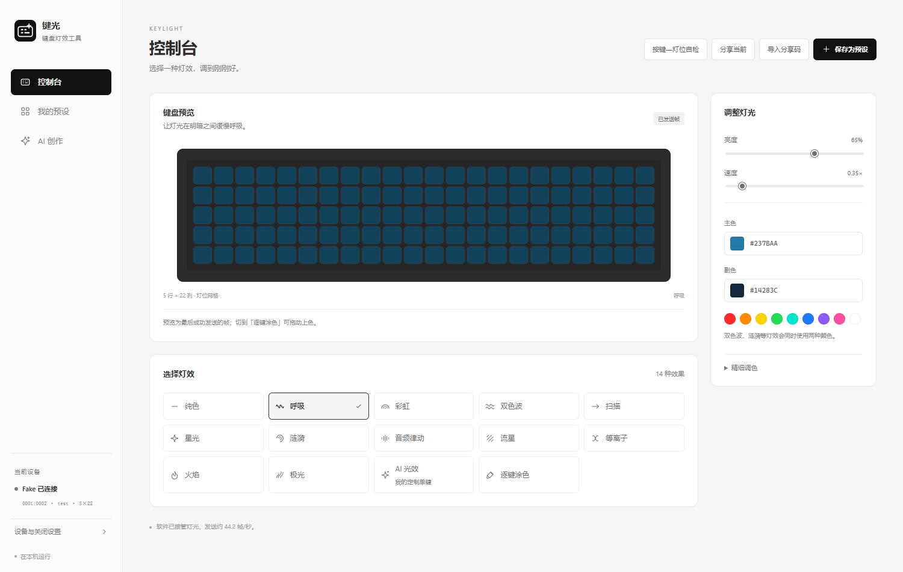

# 键光 · KeyLight

简约黑白界面的 Windows 键盘灯光工具，支持实时灯效、逐键涂色、音频律动、预设分享，以及通过自然语言持续创作自己的灯效。

**当前版本：1.7.0** · Windows x64 · 独立软件窗口 · 非狼蛛官方产品。

## 下载与安装

前往 [Releases](https://github.com/baixiangguo-box/KeyLight/releases/latest)，下载 `KeyLight-Setup-1.7.0-win64.exe`，或包含教程、许可与校验文件的 `KeyLight-1.7.0-Windows-x64.zip`。

双击安装后，从桌面“键光”进入；无需自行安装 Python。需要微软 WebView2，系统缺少时安装器会联网补齐。安装包尚未购买代码签名证书，请核对发布来源及 SHA256。

## 兼容范围

| 型号 | 状态 |
| --- | --- |
| 狼蛛 WIN 60 HE | 已实机验证的适配型号 |
| 狼蛛 WIN 68 HE | 有适配器，尚未实机验证 |
| F75、F87、F99、PRO/MAX/SE/ULTRA 等其他系列 | 当前没有对应灯光适配器 |

连接设备能被识别，不代表支持其灯光协议。设备目录中的127条记录还含鼠标和接收器，不能视为兼容列表。详见 [兼容性与运行边界](docs/COMPATIBILITY.md)。

## 功能

- 黑白粒子行星开屏，平滑鼠标/触摸交互，粒子汇聚为键盘预览；支持减少动态效果与图形降级，进入后释放动画资源。
- 14种灯效入口，速度、亮度、主副色可调，涟漪与交错/中心辐射音频响应。
- 精确按键布局、映射自检和本机校准，逐键涂色与本地预设。
- 离线分享码包含完整作品参数；接收者复制导入即可还原，输入响应随对方按键和声音变化。
- AI创作：直接描述、试用预览、继续反馈。明确需求自动从零生成程序，不需另点生成；软件负责运行检查、重试与需求复查。预览与当前灯光分离，点击“应用到键盘”才采用草稿。
- AI对话、草稿、最近8次撤回、作品改名与删除保存于本机。调用时会将近期对话、草稿及模拟预览反馈发送到用户配置的模型接口；API Key用于接口认证，不进入分享码。

AI功能需要用户自己的兼容接口和API Key，接口费用由所选服务收取。自动检查有边界，不能保证任意描述或模型都成功；失败保留已有草稿，可继续反馈。



上图来自隔离的假设备界面回归，仅展示软件界面。

## 关闭软件后的灯光

WIN60 HE支持的内置模式可保存到键盘，速度/亮度使用固件档位。AI、音频及其他软件计算动画需要程序运行，关闭时保存电脑配置后退出，动态计算随之停止。最小化可继续运行；关闭后不驻留托盘。不能把任意自定义程序写成键盘离线动画。

## 从源码运行

Windows x64，Python 3.12：

```powershell
python -m venv .build/venv
.build/venv/Scripts/python.exe -m pip install -r requirements.txt pywebview==6.2.1
.build/venv/Scripts/python.exe keylight_launcher.py
```

独立窗口依赖 WebView2。`aula_studio.py` 保留源码浏览器模式。安装版数据位于 `%LOCALAPPDATA%/KeyLight/data`；源码默认数据位于 `studio/`，可用进程级 `KEYLIGHT_DATA_DIR` 指定独立目录。

```powershell
.build/venv/Scripts/python.exe -B -m unittest discover -s tests -v
```

浏览器回归须先运行 `tests/ui_fixture.py --port 8799`，再用 Node.js 运行 `tests/browser_check.mjs`。该套件只允许隔离假设备端口8799，不能指向真实软件服务。

完整打包步骤见 [构建说明](packaging/README.md)。源代码和构建脚本不包含私有配置、个人作品、聊天记录或厂商原始驱动脚本。

## 验证与文档

1.7.0通过163项离线单元测试、59项隔离假设备浏览器检查，以及原生窗口生命周期和冻结创作链路验证。另经授权用真实模型完成四类原创灯效、连续修改和普通讨论，并独立重绘检查输入、时序、亮度与音频响应。有限采样不等于所有未来输入均已验证，其他型号和主观体验仍需实物验收。

- [使用教程](docs/使用教程.html)
- [版本更新](CHANGELOG.md)
- [测试说明](docs/VALIDATION.md)
- [第三方声明](THIRD_PARTY_NOTICES.md)

本仓库尚未指定统一源码许可证；第三方组件分别遵循其原许可。请勿将公开可见误认为已获得第三方或全部源码的任意再许可。
